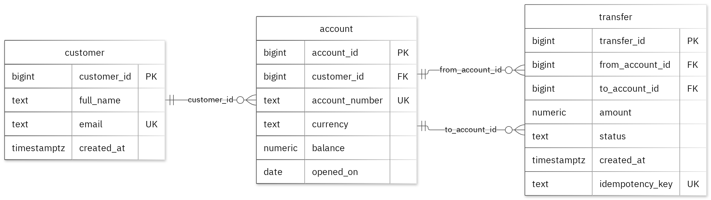

# MIT 8103 Advanced Database Systems

**MIT 8103: Bank / Fintech Platform** · Osareme Tukele · Student ID 301919921

## Case study

For my case study, I worked on MIT 8103: Bank / Fintech Platform, designing a database around three core user roles: customers tracking their account activity, operations staff monitoring transactions, and developers maintaining the platform. The database consists of three primary tables: customer, account, and transfer. It supports essential banking operations, including creating customer and account records, recording transfers between accounts, reviewing transaction histories by account and status, and summarising transfer amounts by account.

## Portfolio 1: Database Design and Modelling

I structured the relational database into three tables, using primary keys to uniquely identify records, foreign keys to maintain relationships, and constraints to enforce the defined business rules. These constraints ensure that account balances cannot fall below zero. The normalisation examples demonstrate how the sample data meets the requirements of 1NF, 2NF, and 3NF. All 12 intentionally invalid INSERT statements were successfully rejected without affecting the existing valid records.

Figure 1. Tables, keys and relationships. PK: primary key; FK: foreign key; UK: unique value.

<!-- PAGE BREAK -->

## Portfolio 2: Query Processing and Optimisation

I executed four SQL queries against the sample records. The JOIN query returned two rows, including ACCT-1001 associated with Avery Quinn. To evaluate index performance, I used a separate dataset containing 50,000 performance records. The median lookup time decreased from 2.749 ms to 0.302 ms after indexing, with both test phases returning identical results. The execution plan confirmed that the newly created index was being used. These performance measurements are specific to the tested query and environment.

## Portfolio 3: Transactions and Concurrency

I used a temporary counter in the transfer table to demonstrate transaction management, including COMMIT, ROLLBACK, and READ COMMITTED isolation. The uncommitted update was not visible to the second session, while ROLLBACK successfully restored the previously committed value. In the concurrency test, two increments without locking resulted in a final counter value of 2. When SELECT FOR UPDATE was applied, Session B waited for Session A to complete, and the final counter value was correctly updated to 3. The temporary counter was used solely for this exercise, leaving the case study's original business fields unchanged.

## Portfolio 4: NoSQL and Advanced Data Models

I used the transfer_events collection to store event documents for the case study. MongoDB successfully inserted four sample events, and all four queries returned the expected results. Validation checks also correctly rejected an invalid date type and a duplicate event ID. Embedded snapshots keep related information within each event document, while the details field accommodates variations across different event types. All events are fictional, and PostgreSQL remains responsible for enforcing the relational database constraints.

## Repository and evidence

https://github.com/NobleOsas/Tukele_Osareme_301919921

The portfolio folders contain the SQL and JavaScript, explanations, query plans, result tables and screenshots.

<!-- PAGE BREAK -->

## Portfolio 5: Distributed and Cloud Database Exercise

I proposed a MongoDB replica set consisting of three members distributed across separate failure zones. The discussion examines primary elections, majority write acknowledgement, secondary replication lag, and the trade-offs of sharding the transfer_events collection. Replication provides high availability, while backups support data recovery. PostgreSQL requires a separate availability and recovery strategy. This implementation was limited to the permitted discussion option; no live replica set was configured, and no failover testing was performed.

## Individual reflection

I designed the database with separate customer, account, and transfer tables to avoid unnecessary duplication and allow related records to be maintained independently. A database constraint ensures that account balances cannot fall below zero, while the constraint tests validate this rule alongside the required field values and relationships between records.

The two-session exercise demonstrated a concurrency issue in which both sessions could read the same account value before either update was committed. Applying a row-level lock before reading ensures that both increments are preserved. The index performance comparison also highlighted the need to examine execution plans alongside query results, since identical results can involve significantly different levels of database processing.

## AI-use declaration

I used GitHub Copilot and the portfolio generator to help prepare the database model, scripts and explanations. The generator ran the PostgreSQL and MongoDB exercises, checked their outputs and captured the result images.  I remain responsible for checking and explaining the submitted work.

## References

- [PostgreSQL: constraints](https://www.postgresql.org/docs/17/ddl-constraints.html)
- [PostgreSQL: EXPLAIN](https://www.postgresql.org/docs/17/using-explain.html)
- [PostgreSQL: isolation](https://www.postgresql.org/docs/17/transaction-iso.html)
- [PostgreSQL: row locks](https://www.postgresql.org/docs/17/explicit-locking.html)
- [MongoDB: data modelling](https://www.mongodb.com/docs/manual/data-modeling/)
- [MongoDB: replication](https://www.mongodb.com/docs/manual/replication/)
- [MongoDB: sharding](https://www.mongodb.com/docs/manual/sharding/)
- [Mermaid: ER diagrams](https://mermaid.js.org/syntax/entityRelationshipDiagram.html)

